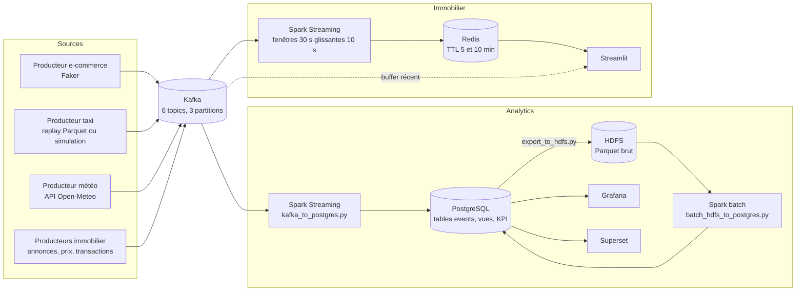

# kafka-spark-pipeline

Un pipeline de streaming qui fait circuler des événements e-commerce, taxi, météo et immobiliers de Kafka vers Spark, puis vers PostgreSQL, HDFS, Redis, Grafana, Superset et Streamlit, le tout démarré par Docker Compose.

## Ce que ça apporte

- **Une pile entière, par couches.** `docker compose up -d` lance le socle (Kafka, Kafka UI, cluster Spark). Trois profils ajoutent chacun un étage : `immobilier`, `analytics`, `superset`.
- **Deux modes de calcul, côte à côte.** Spark Structured Streaming agrège en fenêtres glissantes vers Redis. Un job Spark batch relit des Parquet sur HDFS et calcule neuf tables de KPI dans PostgreSQL.
- **Une chaîne testable sans broker.** Les générateurs d'événements se vérifient par cinq tests `pytest` qui n'ont besoin ni de Kafka ni de Docker.

## Le problème

Un site marchand enregistre une commande toutes les secondes. Le tableau de bord de la direction affiche pourtant le chiffre d'affaires d'hier. Entre les deux, il manque un maillon qui reçoit les événements, les nettoie, les agrège et les publie sans que personne ne lance de script à la main.

Ce dépôt construit ce maillon de bout en bout. Il reste local, reproductible et lisible. Les données sont simulées ou publiques : il n'y a pas de client réel derrière.

## Démarrer en cinq minutes

Prérequis : Docker avec Compose, Python 3.

```bash
cp .env.example .env        # puis remplacer les valeurs factices change_me_*
docker compose --profile analytics up -d --build
pip install -r src/producers/requirements.txt
python scripts/launch_all_producers.py
python -m pytest
```

Grafana répond ensuite sur `http://localhost:3101`, Kafka UI sur `http://localhost:8080`, le Spark master sur `http://localhost:8090`. Le job de streaming vers PostgreSQL démarre seul, après une attente de 45 secondes prévue dans l'entrypoint.

## Comment ça marche



Trois choix structurent le dépôt.

**Deux écoutes pour un seul broker Kafka.** Le broker annonce `kafka:29092` aux conteneurs et `localhost:9092` à la machine hôte. Les jobs Spark restent dans le réseau Docker. Les producteurs, eux, se lancent depuis votre terminal sans configuration réseau.

**Des profils Compose plutôt qu'un fichier géant à tout lancer.** Le socle tient sur une machine modeste. HDFS, PostgreSQL et Grafana n'arrivent qu'avec `--profile analytics`. Redis et Streamlit n'arrivent qu'avec `--profile immobilier`. Chaque étage se démarre, se casse et se débogue seul.

**Redis pour le chaud, PostgreSQL et HDFS pour le durable.** Côté immobilier, les agrégats sont écrits avec une durée de vie (5 minutes pour les fenêtres, 10 minutes pour les villes) et un historique borné à 100 entrées. Le dashboard lit des chiffres frais sans accumuler. Côté analytics, les événements bruts sont ajoutés en base par micro-lots de 10 secondes, au plus 2000 offsets par lot. Les KPI sont ensuite recalculés en batch et écrasés, ce qui rend le calcul rejouable.

Les secrets ne vivent jamais dans le code : `docker-compose.yml` refuse de démarrer si `POSTGRES_PASSWORD`, `GRAFANA_ADMIN_PASSWORD` ou les variables Superset manquent dans `.env`.

## Stack

| Couche | Technologie |
|---|---|
| Messagerie | Apache Kafka et Zookeeper (Confluent 7.5.0), Kafka UI |
| Calcul | Apache Spark 3.5 (PySpark), Structured Streaming et batch |
| Stockage | PostgreSQL 15, HDFS (Hadoop 3.2.1), Redis 7 |
| Visualisation | Grafana 10.2, Apache Superset 3.0, Streamlit, Plotly |
| Producteurs | Python, kafka-python, Faker, pandas, pyarrow, requests |
| Orchestration | Docker Compose, profils |
| Tests | pytest |

## Structure du dépôt

```
docker-compose.yml     pile unique, profils immobilier / analytics / superset
docker/                Dockerfile (spark, producteurs, dashboard), entrypoint Spark, SQL d'initialisation
config/                Grafana (sources, dashboards), Hadoop, Spark, Superset
src/producers/         quatre producteurs Kafka (e-commerce, taxi, météo, immobilier)
src/spark/             jobs : kafka_to_postgres, export_to_hdfs, batch_hdfs_to_postgres
src/spark/immobilier/  streaming par fenêtres et stockage Redis
src/dashboard/         application Streamlit, client Redis, consommateur Kafka
scripts/               lancement des producteurs, init HDFS, dashboards Grafana et Superset, diagnostic
tests/                 tests des générateurs d'événements
```

## Limites et suite

Le périmètre est celui d'un pipeline d'apprentissage et de démonstration, et il est choisi ainsi : un seul broker, un seul worker Spark, une réplication à 1, des données simulées ou publiques. Cela garde l'ensemble reproductible sur un poste, au prix d'aucune tolérance aux pannes.

Quelques points sont connus et assumés :

- Les événements arrivent dans HDFS par un export depuis PostgreSQL (`export_to_hdfs.py`), pas par une écriture directe du flux.
- Les checkpoints du streaming sont dans `/tmp`. Un conteneur recréé repart de zéro.
- Dans l'entrypoint Spark, le mode `immobilier` attend le cluster mais ne soumet pas encore le job. Le code du job est dans `src/spark/immobilier/streaming_immobilier.py` et reste à brancher.
- `scripts/check_pipeline.py` sonde Grafana sur le port 3000, alors que Compose l'expose sur 3101.
- Les tests couvrent les générateurs. Les jobs Spark se vérifient en lançant la pile.

La suite logique : brancher le job immobilier, écrire le flux vers HDFS directement, ajouter des tests d'intégration sur les transformations Spark.

## Licence et contact

Tous droits réservés. Le code est visible pour consultation. Toute réutilisation demande l'accord de l'auteur.

Contact : [Jean-Paul15](https://github.com/Jean-Paul15) sur GitHub.
